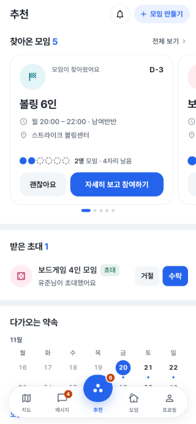
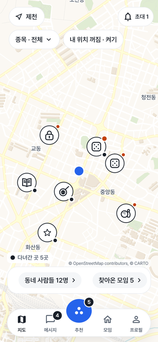
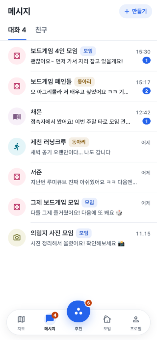

# 동네모여: 소개·체험·설문 사이트

> 찾지 마세요, 모임이 찾아옵니다.

**🔗 https://localmoyeo.kro.kr**

동네모여는 소도시 맞춤형 동네 소모임 앱이에요. 관심사와 되는 시간을 적어 두면, 맞는 사람이 3명 이상 모였을 때 앱이 동네 가게(보드게임카페·볼링장·공방 등)에서 모일 자리를 먼저 제안해요.

이 레포는 앱을 내기 전에 쓰는 웹사이트예요. 설치 없이 웹에서 앱을 둘러보고, 5분 익명 설문에 답할 수 있어요.

<p>
  
  
  
  
</p>

## 페이지

| 주소 | 내용 |
|---|---|
| [`/`](https://localmoyeo.kro.kr) | 앱 소개, 웹 체험, 이용자 설문 |
| [`/owner/`](https://localmoyeo.kro.kr/owner/) | 사장님께 드리는 동네모여 안내 |

## 구조

| 경로 | 내용 |
|---|---|
| `index.html`, `css/`, `js/` | 정적 페이지 (빌드 도구 없음) |
| `content/*.json` | 설문 문항과 안내 문구 |
| `app/` | Flutter 웹 빌드 결과물 (웹 체험용) |
| `img/` | 아이콘, OG 이미지, 앱 화면 캡처 |

## 로컬에서 보기

```bash
python -m http.server 8000
# → http://localhost:8000
```

`main` 브랜치 루트가 GitHub Pages로 배포돼요 (커스텀 도메인은 `CNAME`).
